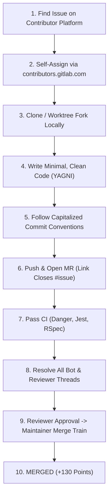

# The Definitive GitLab Hackathon Playbook 🚀

> **The battle-tested field guide for developers, security researchers, and open-source contributors participating in the official GitLab Hackathon.**

Written from real-world experience during the GitLab Hackathon, this playbook walks you through every layer of contributing to enterprise-grade GitLab codebases—from finding issues and bypassing common CI pitfalls, to landing production merges in `gitlab-org/gitlab` core and mastering the community review system.

---

## 🏆 Table of Contents

1. [Why This Guide Exists](#-why-this-guide-exists)
2. [The Anatomy of a GitLab Hackathon](#-the-anatomy-of-a-gitlab-hackathon)
3. [The Golden Rules (Avoid Disqualification)](#-the-golden-rules-avoid-disqualification)
4. [Step-by-Step Contribution Pipeline](#-step-by-step-contribution-pipeline)
5. [Deep Dive Documentation](#-deep-dive-documentation)
6. [Tools & Automation Scripts](#-tools--automation-scripts)
7. [Case Studies: Real Merged MRs](#-case-studies-real-merged-mrs)
8. [FAQ & Common Traps](#-faq--common-traps)

---

## 💡 Why This Guide Exists

Contributing to GitLab isn’t like contributing to an ordinary GitHub repository:
- `gitlab-org/gitlab` is one of the largest Ruby on Rails + Vue monorepos on Earth (>100,000 files, massive test suites).
- CI pipelines execute over 100 parallel jobs, including `as-if-foss`, `jest-predictive`, `rspec-ee`, and strict `danger-review`.
- Multi-tier reviews involve Community Coaches, Domain Reviewers, and Maintainers before code touches `master`.
- Hackathon leaderboards reward points, but **strict community rules govern issue assignment, duplicate work, and quality standards**.

This guide reveals the exact blueprints to navigate these systems with speed, precision, and confidence.

---

## 📊 The Anatomy of a GitLab Hackathon

### Point Structure
| Contribution Type | Points Awarded | Notes |
| :--- | :--- | :--- |
| **Merged Code MR** | **+130 Points** | Highest value; requires green CI and maintainer approval |
| **Merged Documentation MR** | **+25 Points** | Fast turnaround; technical writer review |
| **Translation / CrowdIn Strings** | **Variable (Volume-based)** | Good for incremental score bursts |
| **Issue / Note Bonus Points** | **Awarded by Team** | High-quality triage and discussions |

### Repository Ecosystem
You are not limited to just the main rails repo! Points count across the entire `gitlab-org` group:
- `gitlab-org/gitlab`: Core product (Rails, Vue 3, GraphQL, PostgreSQL).
- `gitlab-org/editor-extensions/gitlab-lsp`: Language Server & Duo CLI (TypeScript, Node.js).
- `gitlab-org/terraform-provider-gitlab`: Official Terraform provider (Go).
- `gitlab-org/omnibus-gitlab`: Enterprise package builder (Chef, Ruby, Docker).
- `gitlab-org/modelops/.../ai-assist`: AI Gateway & Duo code suggestions (Python, FastAPI).

---

## ⚠️ The Golden Rules (Avoid Disqualification)

### Rule 1: Never Submit Duplicates
Before touching code on an issue, always check if an active merge request already references that issue. If another contributor opened an MR first, do not open a second one—collaborate on theirs or pick a different issue.

### Rule 2: The Assignment Rule (The #1 Beginner Trap)
> [!IMPORTANT]
> **You MUST be assigned to an issue before or when working on an MR.**

* **The Trap**: Many newcomers comment `@gitlab-bot assign` on the issue. **The bot does not recognize this command!** Nothing happens, the issue remains unassigned, and your MR will trigger a hackathon rule violation.
* **The Solution**: Use the official **[GitLab Contributor Platform](https://contributors.gitlab.com)**:
  1. Log into `contributors.gitlab.com`.
  2. Open: `https://contributors.gitlab.com/manage-issue?projectPath=<path>&issueIid=<iid>&action=work`
  3. Click **"Assign me"** (or **"Assign issue"**).
* **The Platform Cap**: `contributors.gitlab.com` enforces a limit of around 8–10 active assigned issues per contributor. If you hit the cap, you must politely ask in the issue thread:
  > *"Hi team, I am working on a fix in MR !<number>. Could a maintainer please assign this issue to me for the GitLab Hackathon? Thank you!"*

---

## 🗺️ Step-by-Step Contribution Pipeline

---

## 📚 Deep Dive Documentation

Detailed chapters are available in the [`docs/`](./docs) folder:

- **[01. Prerequisites, Setup & Git Pitfalls](./docs/01-prerequisites-and-setup.md)**: Forking, personal access tokens, git clone strategies, SSH keys, GPG signing gotchas, and Danger commit message rules.
- **[02. Issue Discovery & Self-Assignment](./docs/02-issue-discovery-and-assignment.md)**: Navigating `contributors.gitlab.com`, direct URL formats, managing the 10-issue cap, and working etiquette.
- **[03. Writing Code & Passing GitLab CI](./docs/03-writing-code-and-passing-ci.md)**: Dealing with `as-if-foss`, `jest-predictive`, Apollo GraphQL mock stripping in Vue, and RSpec backend tests.
- **[04. Code Reviews, Threads & Merge Trains](./docs/04-navigating-code-reviews-and-merge-trains.md)**: Understanding MWPS (Merge When Pipeline Succeeds), resolving hidden bot threads, and working with maintainers across timezones.
- **[05. Hackathon Strategy & Leaderboard Optimization](./docs/05-scoring-strategy-and-leaderboard-tactics.md)**: Maximizing points over 48 hours, balancing complex code MRs with rapid doc fixes and translations.

---

## 🛠️ Tools & Automation Scripts

Check the [`scripts/`](./scripts) directory for production-tested Python scripts used during the hackathon:
* [`scripts/mr_status_checker.py`](./scripts/mr_status_checker.py): Real-time CLI dashboard displaying pipeline statuses, mergeability, approvals, and blocking discussions across all your open MRs.
* [`scripts/issue_assigner.py`](./scripts/issue_assigner.py): Parses all open MRs, maps them to linked issues, checks assignment states, and generates 1-click contributor platform URLs.

---

## 🌟 Real Merged Case Studies

Here are real production merges executed during the GitLab Hackathon to study for reference:
* **[gitlab!261153](https://gitlab.com/gitlab-org/gitlab/-/merge_requests/261153)**: Fixed workspace clone command for non-ASCII UTF-8 branch names in GitLab Workspaces.
* **[gitlab!261100](https://gitlab.com/gitlab-org/gitlab/-/merge_requests/261100)**: Added pagination validation in Branches API with complete RSpec coverage.
* **[gitlab!260890](https://gitlab.com/gitlab-org/gitlab/-/merge_requests/260890)**: Updated AuditLog spec fixtures for 3-level OpenBao secret manager paths.
* **[gitlab-lsp!4405](https://gitlab.com/gitlab-org/editor-extensions/gitlab-lsp/-/merge_requests/4405)**: Defaulted CLI plugin commands to warning log level with stderr writer in TypeScript.

---

## 🤝 Contributing & License

Feel free to fork this playbook, submit pull requests with your own tips and lessons learned, and share it with your university, hackathon team, or developer community!

Licensed under the **MIT License**.
